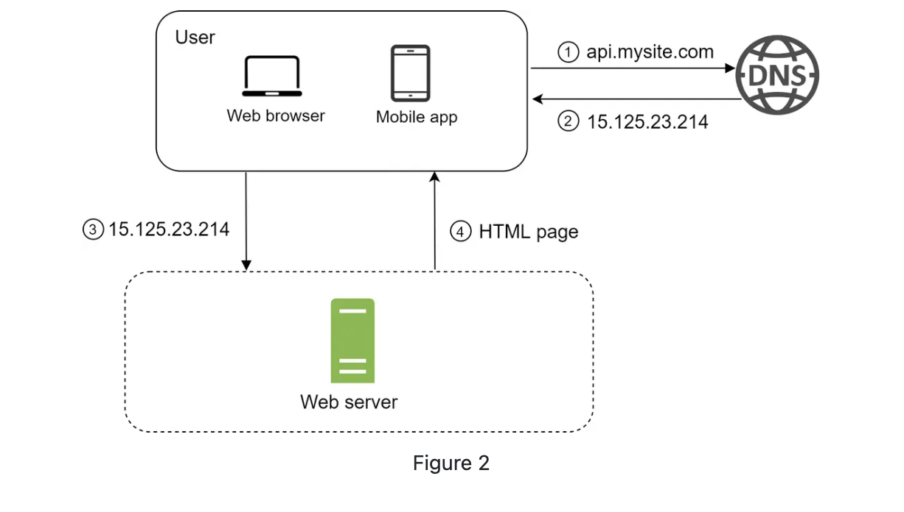
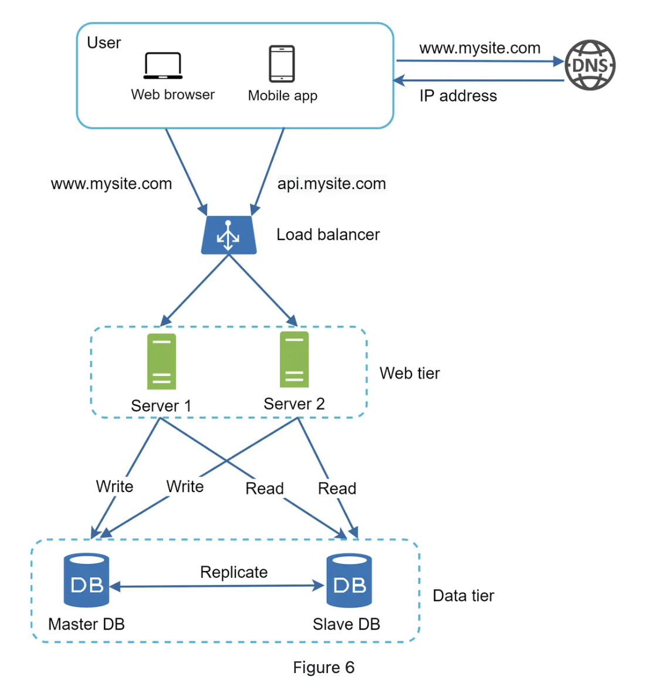
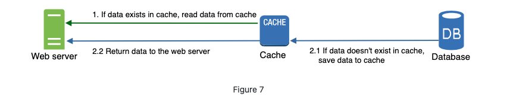
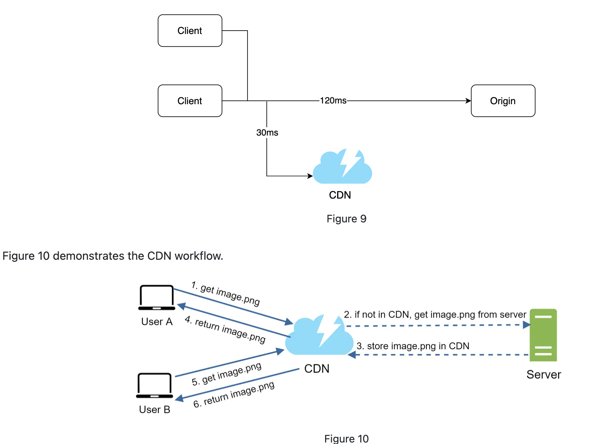
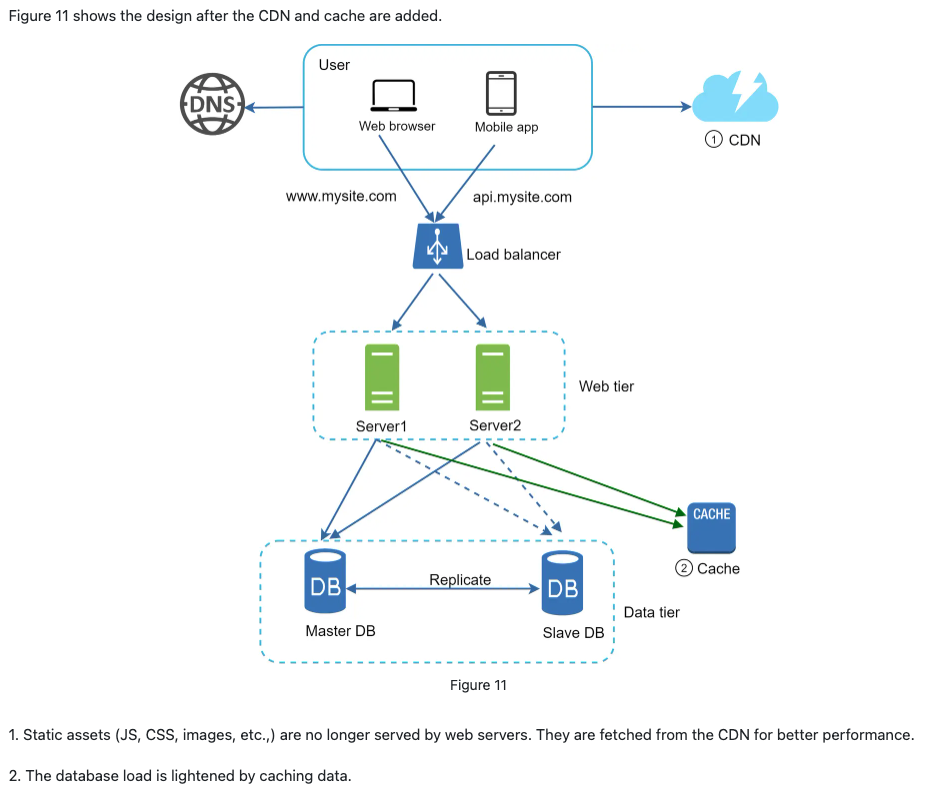
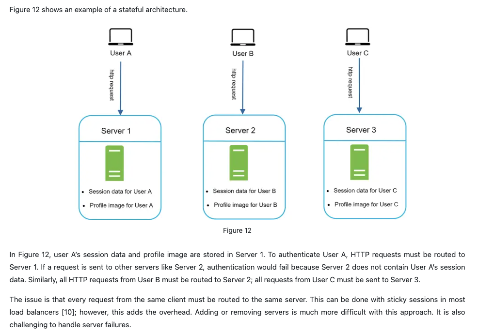
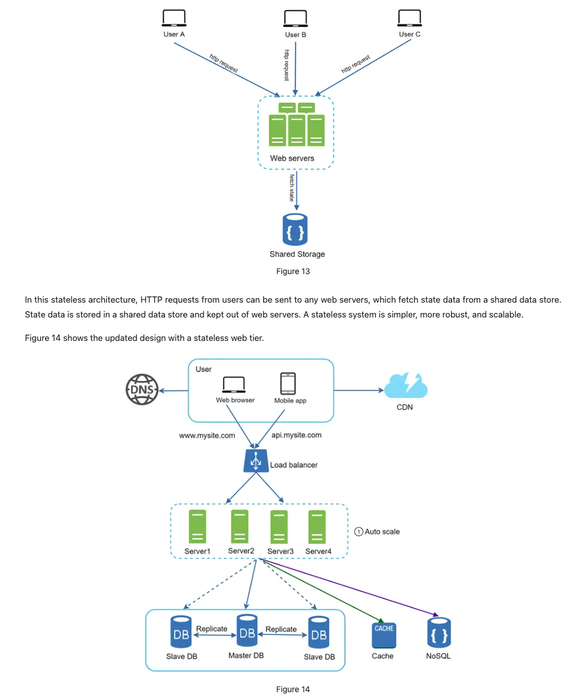

# Single Server Setup

# Database
- RDBMS (Relational database management system) / SQL database
    - e.g., MySQL, Oracle database, PostgreSQL, etc.
    - feature:
        - represent and store data in tables and rows
- NoSQL databases
    - e..g, CouchDB, Amazon DynamoDB, etc.
    - grouped into four categories:
        - key-value stores
        - graph stores
        - column stores
        - document stores
    - join operations are generally not supported 
    - might be right choice if:
        - the app requires super-low latency
        - data are unstructures, or do not have relational data
        - only need to serialize and deserialize data (JSON, XML, YAML, etc.)
        - need to store a massive amount of data

# Vertical scaling vs. Horizontal scaling
- Vertical scaling
    - means the process of adding more power (CPU, RAM, etc) to your servers.
    - good choice when:
        - traffic is low: as simplicity of vertical scaling is its main advantage
    - limitations:
        - has a hard limit: 
            - impossible to add unlimited CPU and memory to a single server
        - does not have failover and redundancy: 
            - if one server goes down, the website/app goes down with it completely
- Horizontal scaling
    - "scale-out", allows to scale by adding more servers into your pool of resources
    - good choice when: 
        - the applications is large scale

# Load balancer
- A load balancer distributes incoming requests across multiple servers to ensure no single server becomes a bottleneck.
- **Why do we need?**
    - without LB: 
    `User → Server A ❌ (overload / single point of failure)`
    - with LB:
             → Server A
        User → LB → Server B
             → Server C
- **Benefits:**
    - **Scalability (horizontal scaling)**
        - the ability of a system to handle increased traffic by adding more resources
        - how it works:
            - if the website traffic grows rapidly, and the current servers are not enough to handle the traffic, we can add more servers to the web server pool
            - and then the LB automatically starts to distributes incoming requests across them.
    - **High Availability**
        - ensures that the system remains operational even when some components fail.
        - how it works:
            - Health checks detect failed servers
            - Traffic is redirected to healthy servers
            - Faulty servers are removed from rotation
    - **Fault Tolerance**
        - the ability of a system to continue functioning even when some components fail
        - how it works:
         - Redirects traffic when a server fails.
    - **Better Performance**
        - refers to how fast the system responds and how many requests it can handle.
        - how it works:
            - Parallel Processing: lower latency, higher throughput
            - Geographic Routing: Reduced network latency

# Database replication

Database replication is the process of copying and maintaining the same data across multiple database servers.
- Master database (primary) - Slave database (copies)
- Why do we need Database Replication?
    - **High Availability**
        - If the primary DB fails, a replica can take over -> Ensures system stays online 
        - Even if a database is offline, the website remains in operation as we can access data stored in another database server
    - **Scalability (Read Scaling)**
        - Reads can go to replicas
        - Writes go to primary
        - -> Reduces load on primary
        - NOTE: a slave database only support READ operations, and ALL the data-modifying commands MUST be sent to the master database.
    - **Fault Tolerance**
        - Hardware failure (like caused by natural disaster) won’t lose all data, backup copies exist
    - **Better Performance**
        - All writes and updates happen in master nodes; whereas read operations are distributed across slave nodes
        - -> allow more queries to be processed in parallel
- What if one of the database goes offline?
    - If only one slave database is availble and it goes offline:
        - read operations will be directed to the master dataabse temporarily.
        - as sson as the issue is found, a new slave dataabse will replace the old one.
    - If multiple slave databases are available:
        - read operations are redirected to other healthy slave databases.
        - an ew dataabse server will replace the old one.
    - If the master database goes offline:
        - a slave database will be promoted to be the new master

# Cache
- A cache is a temporary storage area that sotres the result of expensive response or frequently accessed data in memory so taht subsequent requests are served more quickly.
    - Every time a new web page loads, one or more database calls are executed to fetch data -> the app performance is greaty affected by calling the database repeatedly. -> the cache can mitigate this problem  

**Cache tier**
- The cache tier is a temporary data store layer, much faster than database

- Benefits:
    - 1. better system performance
    - 2. ability to reduce database workloads
    - 3. the ability to scale the cache tier independently
- Process:
    - After receivign a request, a web server first checks if the cache has the available response
        - If yes, it sends data back to the client
        - If not, it queries the database, stores the response in cache, and sends it back to the client
- Considerations for using cache:
    - **1. Decide when to use**
        - Consider using cache when data is **read frequently but modified infrequently**.
        - A cache server is not ideal for **persisting data**.
            - as cached data is stored in **volatile memory**  
                - e.g., if a cache server restarts, all the data in memory is lost
            - important data should be saved in persistant data stores.
    - **2. Expiration Policy**
        - Once cached data is expired, it is removed from the cache.
        - When there is no expiration policy, cached data will be stored in the memory permanently.
            - Do not make the expiration date **too SHORT**
                - this will cause the system to reload data from the database too frequently
            - Do not make the expiration date **too LONG**
                - the data can become stale
    - **3. Consistency**
        - Involves keeping the data store and the cache in sync.
        - Inconsistency can happen when data-modifying operations on the data store and cache are not in a single transaction.
    - **4. Mitigating failures**
        - A signle cache server represents a potential single point of failure (SPOF) 系统的单点故障.
            - SPOF: a part of a system that, if it fails, will stop the entire system from working.
        - **Recommend 1: 多个 cache server（分布式部署）**
            - multiple cache servers across different data centers avoid SPOF.
        - **Recommend 2: 内存冗余预留**
            - overprovision the required memory by certain percentages 
                - 不要只给“刚好够用”的内存，要多给一部分“备用空间”
                - this provides a buffer as the memory usage increases. 
    - **5. Eviction Policy**
        - **Cache Eviction**: once the cache is full, any requests to add items to the acche might cause existing items to be removed.
        - Cache eviction policy:
            - **Least-recently-used(LRU)**: most popular 
            - **Least Frequently Used (LFU)**
            - **First in First Out (FIFO)**

# Content delivery network (CDN)
- A CDN is a network of geographically dispersed servers used to deliver static content.   
    CDN 是一个分布在全球的服务器网络，用来把内容从“离用户最近的服务器”快速发送给用户。
- **Dynamic Content Caching**
    - relatively new concept
    - enables the caching of **HTML pages** that are based on request path, query strings, cookies, and request headers. 
- **Static Content Caching**
    - like images, videos, CSS, JavaScript files, etc.
- **How CDN works at the high-level**  
    When a user visits a website, a CDN server closest to the user will deliver static content.
    - The further users are from CDN servers, the slower the website loads.

- **Consideration of using a CDN**
    - **COST**
        - CDNs are run by third-party providers, and we are charged for data transfers in and out of the CDN.
        - Caching **infrequently used assets** provides no significant beenfits -> should consider moving them out of the CDN.
    - **Setting an appropriate cache expiry**
        - Important for time-sensitive conetnt.
        - Should neither be too long nor too short.
            - Too Long: the content might no longer be fresh;
            - Too Short: cause repeat reloading the content from origin servers to the CDN.
    - **CDN fallback**
        - Should consider how website/application copes with CDN failure.
        - If there is a temporary CDN outage, clients should be able to detect the problem and request resources from the origin. 
    - **Invalidating files**
        - Remove a file from the CDN before it expires by performing one of the following ops:
            - 1. Invalidate the CDN object using APIs provided by CDN vendors.
            - 2. Use object versioning to serve a different version of the object.
                - To version an object, can adda parameter to the URL, such as a version number.
                - e.g., image.png?v=2.

# Stateless web tier
Stateless web tier 指的是：每个 web server 都不保存用户状态（state），任何请求都可以被任意服务器处理。
- Good practice is to store session data in the persistent storage such as relational database or NoSQL.
    - Each web server in the cluster can access state data from databases.

## Stateful architecture
- Stateful Server vs. Stateless Server
    - A stateful server remembers client data (state) from one request to the next.
    - Stateless server keeps no state information.

## Stateless architecture
- Request Process:
    - User -> Load Balancer -> Any Server

- Stateless server move the session data out of the webtier, and store them in the persistent data store.
    - the shared data store could be 
        - a relational database
        - Memcached/Redis (分布式缓存)
        - NoSQL
            - This figure chose the NoSQL as it is easy to scale.
        - JWT (客户端)
            - Token存在浏览器，每次请求带上
    - Autoscaling means adding or removing web servers autoamtically based on the **traffic load**.
- Benefits:
    1. Scalability (Horizontal Scaling)
        - Stateless services can easily scale horizontally by adding or removing servers, since no session data is tied to any specific instance.
    2. High Availability & Fault Tolerance
        - If one server fails, requests can be routed to other servers without impacting users, as no state is lost.
    3. Simplified Load Balancing
        - Requests can be **distributed evenly** across servers **without requiring sticky sessions or session affinity**.
    4. Improved Performance Under Load
        - Traffic can be handled more efficiently by distributing requests across multiple instances, reducing bottlenecks.
    5. Easier Deployment & Maintenance & Better System Realibility
        - Servers can be restarted, replaced, or updated independently without affecting user sessions.
        - Since state is externalized (e.g., Redis, database, or client-side tokens), the system is more resilient to individual node failures.
    